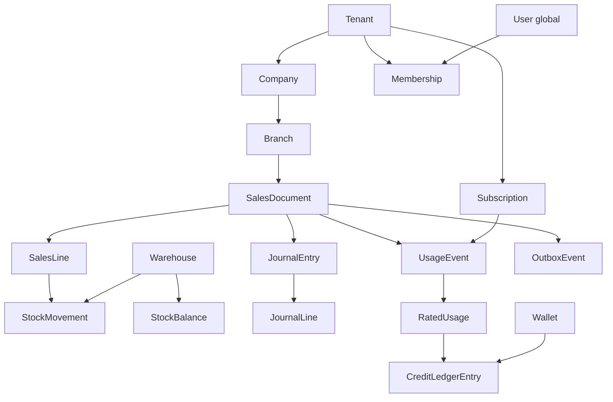

# DATABASE_ARCHITECTURE.md

> ERP SaaS — Database Architecture | Version: 0.1 | Date: 2026-10-11 | Document status: **PROPOSED**
>
> Scope: PostgreSQL mantiqiy data modeli, tenant isolation, transaction correctness, indekslar, pooling, partition, replication, backup, sharding va migration.
>
> **Status qoidasi:** `APPROVED` — loyiha bo‘yicha avvaldan tasdiqlangan biznes talab; `PROPOSED` — ushbu hujjatda tavsiya etilgan, hali tasdiqlanmagan texnik yechim; `OPEN QUESTION` — tegishli modul bilan hal qilinadigan masala. Bu hujjatdagi takliflar avvalgi tasdiqlangan qarorlarni bekor qilmaydi.

## 1. Maqsad, chegaralar va asosiy prinsiplar

1000+ kompaniya, filiallar, parallel foydalanuvchilar va katta hujjat/ombor/billing oqimiga xizmat qilish. `1000+` — capacity planning uchun talab, muayyan TPS yoki latency kafolati emas: yuklama profili benchmark bilan aniqlanadi.

- **Database Architecture egasi:** persistence qoidalari, entity relationship, transactional boundary, referential integrity, indekslar, migration, availability va recovery.
- **Multi-Tenant Architecture egasi:** tenant/company/branch semantikasi, tenancy lifecycle, enterprise isolation mezonlari.
- **Security egasi:** authorization siyosati, membership/branch permission va ma’lumotlar maxfiyligi; DB RLS — defense-in-depth.
- **Sales/Inventory egasi:** stock reservation, negative stock, cost flow va document lifecycle biznes qoidalari.
- **Finance egasi:** posting, chart of accounts, fiscal closing, currency va reversal qoidalari.
- **Billing egasi:** tariflar, rating, kreditlar, minus balans, invoice va Seat/Usage aniq hisoblash qoidalari.

Prinsiplar: tenant containment; biznes hujjati va unga tegishli stock/finance yozuvlarida atomicity; immutable jurnal va kompensatsion reversal; bounded transactions; idempotent retry; indekslarni real query shakliga moslash; dastlab oddiy topologiya, keyin o‘lchovga asoslangan kengayish.

## 2. Tasdiqlangan biznes talablar — APPROVED

1. Hybrid Prepaid SaaS: arzon Seat + Business Usage + Resource Usage.
2. Business Usage — hujjatga asosiy narx, belgilangan hajm chegarasidan keyin qo‘shimcha kredit; hajm bo‘yicha progressiv chegirma va enterprise individual kelishuvlar.
3. **1 kredit = 10 so‘m.** Tarif/miqdorlar hali belgilanmagan.
4. Balans tugaganda **haqiqiy Seat va Usage xarajatlari bir kalendar oy davomida minusga yoziladi**; **taxminiy kredit limiti hisoblanmaydi**. Oy boshlanishi, to‘xtatish va keyingi holat tafsilotlari Billing bo‘limida ochiq.
5. Kompaniya va filiallar yagona SaaS platformasida.
6. UX tillari uz/en/ru; yangi o‘zbek alifbosining yashirin varianti ko‘zda tutiladi. Locale — biznes identifikator o‘rnini bosmaydi.

Go, PostgreSQL, Next.js va Flutter dastlabki **PROPOSED** texnologiyalardir. Ushbu hujjat PostgreSQL ni shartli maqsadli platforma sifatida tahlil qiladi, uni APPROVED deb e’lon qilmaydi.

## 3. Database deployment va ownership — PROPOSED

**Boshlanish:** PostgreSQL primary; modular monolith backend; shared database/shared schema; barcha biznes-scope entitylarida `tenant_id`. Bitta tenant bir nechta company/branchga egalik qilishi mumkinligi variant sifatida saqlanadi; `tenant = company` deb qattiq bog‘lanmaydi. Enterprise uchun kelajakda dedicated DB/cluster.

**Schema konsepsiyasi:** `platform` (global directory, identities), `tenant_core` (organization va memberships), `sales`, `inventory`, `finance`, `billing`, `audit` kabi **modulga oid namespace** tavsiya qilinadi; bu *schema-per-tenant* degani emas. Namespace ajratilishi yakuniy qaror emas. Modullar boshqa modul jadvallariga bevosita biznes yozuvlari yaratmasligi kerak; atomic transaction orkestratsiyasi domain service orqali.

**Data ownership:** global identities va tenant directory — platform; company/branch — tenant core; sale — sales; stock ledger — inventory; journal entries — finance; SaaS wallet/usage/credit ledger — billing. Reporting read models manba emas.

## 4. Mantiqiy ERD: core entities

Belgilar: `1:N` — birga-ko‘p; `(tenant_id, id)` — tenant-scoped mantiqiy identity; `*` — immutable/eventga moyil. Quyidagi katalog ERD, **SQL schema yoki yakuniy field kontrakti emas**.

### 4.1 Platform / identity / tenant

| Entity | Muhim atributlar (mantiqiy) | Relationship / constraint |
|---|---|---|
| Tenant | id, status, region, lifecycle_state | 1:N Company, Membership, Subscription |
| Company | tenant_id, id, legal_name, tax_identity, status | N:1 Tenant; 1:N Branch |
| Branch | tenant_id, company_id, id, name, status | Company va Tenant bilan bir xil ownership |
| User | global id, identity reference, status | global principal; tenant-specific permissions emas |
| Membership | tenant_id, id, user_id, company_scope, state | User N:M Tenant; company/branch scope alohida tekshiriladi |
| Role / PermissionGrant | tenant_id, membership_id, scope, permission | Authorization modelining manbasi Security moduli bilan kelishiladi |
| TenantDataLocation | tenant_id, storage_route, location_version | kelajakdagi tenant -> shard/dedicated DB marshrutlash |

### 4.2 Sales

| Entity | Muhim atributlar | Relationship / constraint |
|---|---|---|
| Counterparty | tenant_id, id, company_id, type | Customer/supplier domain, scope tasdiqlanadi |
| Product | tenant_id, id, sku, unit_id, status | master catalog; company-level visibility qoidasi ochiq |
| SalesDocument | tenant_id, id, company_id, branch_id, status, document_no, posted_at, version | 1:N SalesLine; posting idempotent |
| SalesLine | tenant_id, id, sales_document_id, product_id, quantity, price_snapshot | header bilan tenant composite FK |
| SalesPaymentAllocation | tenant_id, id, sales_document_id, payment_id, amount | to‘lovning sotuv bilan bog‘lanishi, Finance bilan kelishiladi |

### 4.3 Inventory

| Entity | Muhim atributlar | Relationship / constraint |
|---|---|---|
| Warehouse | tenant_id, id, company_id, branch_id?, status | branch bilan bog‘lanish majburiyligi ochiq |
| StockMovement* | tenant_id, id, product_id, warehouse_id, source_document_id, movement_type, quantity_delta, occurred_at | faktlar jurnali; reversal yangi movement orqali |
| StockBalance | tenant_id, warehouse_id, product_id, stock_dimension, on_hand, reserved, version | movementlardan hosil qilingan transactionally maintained balance |
| StockReservation | tenant_id, id, warehouse_id, product_id, source_line_id, qty, status, expires_at | rezervatsiya lifecycle; idempotency |
| StockTransfer | tenant_id, id, from_warehouse, to_warehouse, status | two-leg movements yoki atomic paired posting |
| InventoryCostLayer / ValuationEntry* | tenant_id, id, source_movement_id, cost_snapshot | costing siyosati Inventory/Finance tomonidan belgilanadi |

**Muhim:** StockBalance — faqat tezkor hisob-kitob holati; authoritative audit dalili StockMovement va reservation lifecycle hisoblanadi. Balance qiymatlari transaction doirasida movement bilan birga yangilanadi va reconciliation qilinadi. Bir xil product+warehouse uchun stock dimension (lot/serial/batch) ishlatiladimi — OPEN QUESTION.

### 4.4 Finance & accounting (tenantning o‘z hisob-kitobi)

| Entity | Muhim atributlar | Relationship / constraint |
|---|---|---|
| Account / ChartOfAccounts | tenant_id, company_id, id, code, type | kompaniya bo‘yicha accounting scope |
| FiscalPeriod | tenant_id, company_id, id, start/end, close_status | yopilgan davrga qayta posting cheklanadi |
| JournalEntry* | tenant_id, id, company_id, source_type/id, posting_date, status, reversal_of | 1:N JournalLine; posting atomic |
| JournalLine* | tenant_id, id, journal_entry_id, account_id, debit, credit, currency, base_amount | debit/credit va currency consistency |
| Payment | tenant_id, id, company_id, counterparty_id, method, amount, status | allocation va bank reconciliation qoidalari ochiq |
| TaxDocument / ExchangeRateSnapshot | tenant_id, id, effective_at, value | soliq hamda valyuta yondashuvi keyin tasdiqlanadi |

**Invariant:** posted journal entry bo‘yicha debit va credit **bir xil accounting currency kesimida** muvozanatda bo‘lishi, entry bir marta post qilinishi kerak; posted tarix tahrirlanmaydi, reversal/adjustment yoziladi. Valyuta conversion va rounding siyosati Finance ADRida tasdiqlanadi. SaaS billing wallet bilan korxonaning buxgalteriya ledgeri **ikki alohida domen**.

### 4.5 SaaS Billing (platforma kompaniyaga ko‘rsatadigan xizmat)

| Entity | Muhim atributlar | Relationship / constraint |
|---|---|---|
| Subscription | tenant_id, id, plan_version, status, effective_range | 1:N subscription period, seat policy |
| SeatAssignment / SeatSnapshot | tenant_id, membership_id, effective_from/to, billable_state | billed seat hisoblash manbasi; siyosati Billing bilan kelishiladi |
| PricingVersion | id, tariff_type, valid_from/to, rules_snapshot | immutable effective pricing versiyasi |
| ContractOverride | tenant_id, id, effective_range, pricing_reference | enterprise individual shartnoma |
| UsageEvent* | tenant_id, id, event_key, source_ref, usage_type, measured_quantity, occurred_at, state | source+type orqali at-most-once charge intent |
| RatedUsage* | tenant_id, id, usage_event_id, pricing_version, credits, calculation_snapshot | original event va narx asosi saqlanadi |
| Wallet | tenant_id, id, unit=credit, current_balance (derived/cache) | wallet ≠ korxona accounting balance |
| CreditLedgerEntry* | tenant_id, id, wallet_id, entry_type, signed_credit_amount, ref, created_at | append-only; top-up, usage debit, adjustment, reversal |
| Invoice / InvoiceLine | tenant_id, id, period, status, rated_usage_reference | billing va hisob-faktura holatlari ajratiladi |
| PaymentReceipt | tenant_id, id, provider_event_id, amount, credit_equivalent, status | callback takrorlanishi double top-up qilmasin |
| BillingPeriodState | tenant_id, id, calendar_month, state, debt_tracking_start | minus balans oyning real xarajatlari bilan yuritiladi |

**Invariantlar:** `1 credit = 10 UZS` konvertatsiyasi bo‘yicha hisoblash aniqligi; har bir usage event uchun idempotent rating/ledger posting; posted ledger qatorlar o‘zgarmaydi; wallet cache/summary ledger bilan tekshiriladi. Narx, chegirma va chegara miqdorlari **APPROVED emas**. Minus balansga **oldindan taxminiy kredit ceiling** kiritilmaydi. Salbiy balans davomiyligi va kalendar oy talqini Billing bilan yakunlanadi.

### 4.6 Audit, outbox, operational metadata

| Entity | Muhim atributlar | Relationship / constraint |
|---|---|---|
| AuditEvent* | tenant_id?, actor_id, action, object_ref, timestamp, hash_ref? | append-only; maxfiy ma’lumot maskalanadi |
| OutboxEvent* | tenant_id, id, aggregate_ref, event_type, payload_version, state, created_at | biznes commit bilan bir transaction; consumers idempotent |
| IdempotencyRecord | tenant_id, operation_scope, request_key, result_ref, state | retry, timeout va double submit nazorati |
| SchemaVersion / MigrationRecord | version, applied_at, compatibility_stage | DB rollout monitoring |

### 4.7 Mantiqiy relationship diagram

Mantiqiy bog‘liqlik real fizik FK degani emas: masalan SaaS billingning Sales `source_ref` i event reference bo‘lib qolishi va DB shardingdan so‘ng cross-shard FK bo‘lmasligi mumkin.

## 5. Tenant isolation va composite foreign keys — PROPOSED (DB-002/003)

**Default:** shared DB / shared schema; tenantga tegishli biznes satrlarida non-null `tenant_id`, composite uniqueness `(tenant_id, id)` va tenant-scoped child -> parent `(tenant_id, parent_id)` referential constraint. Company/branch doirasidagi cross-company bog‘lanishlar zarur joyda `(tenant_id, company_id, id)` kabi ownership key bilan mustahkamlanadi. Global `User` va tarif reference kabi jadvallar bundan mustasno — ruxsat modeli aniq ta'riflanadi.

**Defense-in-depth:** application authorization + PostgreSQL RLS; runtime role `BYPASSRLS`/superuser emas; privileged maintenance role alohida. Connection reuse vaqtida tenant context har bir transaction uchun qat’iy set/reset, fail-closed policy, pool orqali tenant context leakage testlari. RLS membership/branch-level authorizationning yagona mexanizmi sifatida qabul qilinmaydi. Background jobs, reporting, backup, support access hamma yo‘llarda tenant context nazorati.

**Comparison:**

| Variant | Foyda | Narx/xavf | Dastlabki baho |
|---|---|---|---|
| Shared DB + shared schema | Operatsion oddiylik, pooling, yuqori zichlik | Tenant isolation xatosi va noisy neighbor | **PROPOSED default** |
| Schema-per-tenant | Muayyan mantiqiy ajratish | 1000+ schema migration/connection complexity | Default emas |
| Database-per-tenant | Dedicated performance, restore/isolation | 1000+ DB operational cost, fleet migration | Enterprise maxsus |
| Hybrid | Kichik tenantlar shared, yiriklar dedicated | routing va data move murakkab | Kelajak uchun tayyorlik |

**Kritik:** unique/index va FK tenant keyni qamrab olishi global IDni taxminiy isolatsiya deb hisoblamaydi; integratsion testlar cross-tenant spoofingni rad qilishi kerak.

## 6. Transaction, lock, idempotency va consistency — PROPOSED (DB-004/005)

**General:** ACID tranzaksiyalar qisqa bo‘ladi; network/payment gateway kabi tashqi chaqiriqlar DB lock ichida bajarilmaydi. Odatda `READ COMMITTED` + explicit row-level lock/conditional update; stock contention yoki period close uchun zarur bo‘lsa selectively stronger isolation + bounded retries. Deadlockni kamaytirish uchun lock order bir xil, lock timeout/statement timeout va retry siyosati. `SERIALIZABLE` ni hamma operatsiyaga global majburlash taklif etilmaydi.

**Sotuv posting atomiklik (bitta tenant va DB ichida):**
1. Tenant/actor/branch permission va request idempotency tekshiruvi.
2. Document status/version tekshiruvi, kerakli stock balance/reservation qatorlarini tartibli lock qilish.
3. SalesDocument posting + StockMovement + StockBalance/Reservation transition + zarur Finance journal posting + OutboxEvent bitta DB transaction ichida.
4. Hammasi commit yoki hammasi rollback. Billing UsageEvent agar bu transaction ichida emas bo‘lsa, **outbox consumer orqali idempotent eventual posting** (billing charge yo‘qolmasligi uchun retry/reconciliation bilan). Bu boundary Billing/Finance bilan kelishilmaguncha taklifdir.

**Inventory invariants:** `available = on_hand - reserved` (dimension darajasida); negative stock taqiqlansa availability check atomic conditional update bo‘lishi shart. Negative stock siyosati hali OPEN QUESTION. Ikki parallel rezervatsiya bir zaxirani ikkalasi ham ololmaydi. StockTransfer ikki tomonlama atomic movement; alohida shards paydo bo‘lsa transfer saga va compensating actions kerak bo‘lishi mumkin.

**Finance invariant:** journal entry posting = barcha lines bilan atomic; balanced posting, closed period control; reversal only, history immutability.

**Billing invariant:** PaymentReceipt -> CreditLedger top-up once; UsageEvent -> RatedUsage -> debit Ledger once; transaction ichida row lock / atomic wallet summary update; retries double debit qilmaydi. Wallet cached balance ledgerdan reconciliation orqali tekshiriladi; faqat cachega asoslangan charging man etiladi. Ehtimoliy cross-service events har bir consumerda dedupe qiladi.

**Read-after-write:** mutationdan keyin darhol kerakli balans/sotuv holati primarydan o‘qiladi. Replica lag bo‘lgan joyda eventual-consistent hisobot UI sifatida belgilanishi kerak.

## 7. Index, query pattern va connection pooling — PROPOSED (DB-006)

- Tenant-scope querylarda index odatda `tenant_id` dan boshlanadi; keyingi ustunlar `company_id/branch_id`, status, vaqt, yoki lookup kalitiga moslanadi. Hamma joyga har doim bitta indeks qolipi ishlatilmaydi.
- SalesDocument: `(tenant_id, company_id, status, posted_at)` va tenant-scoped document number uniqueness (document numbering scope biznes qarori bilan aniqlanadi).
- StockBalance: `(tenant_id, warehouse_id, product_id, stock_dimension)` exact-lookup uniqueness; StockMovement `(tenant_id, warehouse_id, occurred_at, id)` append/time access.
- Billing UsageEvent: `event_key` + operation scope bo‘yicha uniqueness; ledger `(tenant_id, wallet_id, created_at, id)`; `source_ref` bo‘yicha lookup.
- Finance Journal: `(tenant_id, company_id, posting_date, id)` va source idempotency index.
- Audit/Outbox: processing state + created time uchun selective/partial indexes; time-based retentionda BRIN faqat o‘lchov natijalariga qarab.
- Har bir index INSERT/UPDATE xarajatini oshiradi; slow-query observability, EXPLAIN/actual plans, p95/p99 query latencies va index usage orqali optimizatsiya qilinadi. Katta offset pagination o‘rniga stable keyset cursor tavsiya.
- Pool: bounded app connection pool + transaction pooling (PgBouncer kabi) **PROPOSED**; PostgreSQL `max_connections` ni tenant soniga to‘g‘ridan-to‘g‘ri ko‘paytirmaslik. Sessionga bog‘liq state va prepared statement compatibility alohida test qilinadi. RLS tenant context transaction-local bo‘lishi shart.
- Connection budget primary/replica, workers, migrations, maintenance va support ulushlari bilan hisoblanadi. Tenantga adolatli concurrency quota, rate limits, heavy report isolation va backpressure ishlab chiqiladi.

## 8. Partition va data lifecycle — PROPOSED (DB-006)

**Partition by need, not tenant count:** katta append-only `UsageEvent`, `CreditLedgerEntry`, `StockMovement`, `AuditEvent`, `OutboxEvent` va kerak bo‘lsa `JournalLine` uchun oy/chorak asosidagi **time-range partitioning** ko‘rib chiqiladi. Dastlab benchmark zarur; partitsiya avtomatik tezlik kafolati emas. Hot tenant uchun shard yondashuv alohida.

**PostgreSQL muhim cheklovi:** partitioned table unique/primary key qoidalarida partition kaliti hisobga olinishi talab etilishi mumkin; global event-id yoki idempotency uniqueness faqat time-partitioned child indexiga suyanmasin. Maxsus non-partitioned dedupe registry, vaqt intervali bilan domain key va boshqa variantlar ADRda ishlab chiqiladi. Referential integrity va partition detach/archive imkoniyatlari birgalikda loyihalanadi.

**Lifecycle:** hot OLTP -> warm history -> archive (read-only, huquqiy talabga muvofiq) -> retention tugagach defensible deletion. Financial ledger va auditni oddiy soft-delete bilan yashirish yoki fizik yo‘q qilish mumkin deb taxmin qilinmaydi. Tenant offboarding: legal hold, export, deletion request, key/backup retention va privacy siyosati bilan koordinatsiya. PII minimizatsiyasi, encryption at rest/in transit, secret management va audit trail.

## 9. Replication, availability, backup/restore — PROPOSED (DB-007)

**Initial:** primary + physical streaming standby (HA); optional asynchronous read replica katta hisobot oqimi paydo bo‘lganda. Primary write source; replicas read-only va lag monitor qilinadi; failover orkestratsiyasi, fencing/split-brain prevention va idempotent client reconnection talab etiladi. Replica zero-data-loss yoki doimiy up-to-date read kafolati emas. Synchronous replication faqat latency/availability tradeoff baholangach.

**Backup:** avtomatik base backup + uzluksiz WAL archival + **PITR**, encrypted and offsite copies, backup immutability/access segregation, restore tests. `RPO`, `RTO`, backup retention va geografik compliance muddatlari **OPEN QUESTION**; raqamlar ixtiyoriy o‘rnatilmaydi.

**Tenant restore:** shared database ichida PITR odatda butun cluster/DBga ta’sir qiladi. Bir tenantni recovery qilish uchun **isolated restore environment -> tenant-scoped extraction + reference/integrity validation -> controlled import/reconciliation** jarayoni loyihalanadi; bu oddiy bir tugmali tenant restore emas. Dedicated DB enterprise tenantlarda restore boundary soddaroq.

**Disaster drills:** periodic failover/PITR recovery, audit of restored ledger, zero cross-tenant leakage test, restore time measurement va documented runbooks.

## 10. Sharding va enterprise isolation — PROPOSED (DB-008)

Sharding darhol yoqilmaydi. Avval vertical capacity, query/index improvement, connection pressure, replica reporting, partitionlar va noisy-neighbor isolation ko‘riladi. Shard triggerlari: measurable throughput/IO saturation, tenant skew, RTO/regulatory isolation, enterprise SLA; konkret thresholddar benchmarkdan keyin belgilanadi.

**Shard unit:** tenant; TenantDataLocation registry `tenant_id -> logical shard / region / cluster` mapping va version beradi. Tenant ichidagi transactional core (Sales+Inventory+Finance+Billing) imkon qadar bitta write boundary/shardda turadi. Global identity/control-plane alohida boshqariladi. Cross-tenant join/transaction taqiqlanadi; cross-shard reporting async aggregates orqali.

**Tenant relocation:** freeze/quiesce or CDC-assisted copy -> validation/checksum/ledger reconciliation -> atomic routing cutover -> rollback window. Migration paytida dual-write faqat qat’iy correctness protokoli bo‘lsa; default oddiy controlled cutover. RLS/ownership va audit tekshiriladi.

**Enterprise dedicated DB:** contract/SLA yoki regulatory talab asosida exception; application domain modeli o‘zgarmasligi, migration va monitoring avtomatlashtirilishi shart. Sharding oldidan barcha global ID va reference strategiyalari qayta tekshiriladi.

## 11. Schema migrations — PROPOSED (DB-009)

Expand -> backfill -> verify -> switch reads/writes -> contract. Long-running blocking DDLdan qochish; compatible application/DB versions uchun rollout window; transactional safety, lock budget, migration preflight, abort/rollback playbooks. Yangi required field avval nullable/default handling orqali bosqichma-bosqich. Katta backfill bounded batches bilan, tenant fair scheduling va telemetry orqali. Schema-per-tenant emasligi fleet migrationni soddalashtiradi; dedicated DB fleet bo‘yicha version monitoring kerak.

**Contract tests:** old/new app compatibility, RLS, composite FK, concurrent stock booking, invoice idempotency, payment callbacks, partition boundary va restore/integrity tests.

## 12. Nofunksional acceptance criteria (sonlar keyin aniqlanadi)

- 1000+ tenant synthetic distribution + hot tenant workload bilan load test; target TPS/p95/p99, data volume va concurrency **OPEN QUESTION**.
- Cross-tenant read/write/foreign-key references — **0 successful forbidden operation** (negative security test).
- Bir xil idempotency key bilan takrorlangan payment/usage/sale posting — **1 effective business posting**.
- Parallel sotuv/rezervatsiyada oversell yo‘q, agar negative stock taqiqlangan bo‘lsa.
- Posted finance journals balanced; wallet va ledger reconciliation differences alert + remediation.
- PITR, failover, isolated tenant recovery drill va migration dry run natijalari qayd qilinadi.
- Replica lag, pool wait, lock wait, deadlock count, autovacuum/bloat, WAL growth, replication slot, tenant resource skew va disk usage kuzatiladi.

## 13. ADR katalogi

### ADR-DB-001 — PostgreSQL transactional store
- **Status:** PROPOSED.
- **Muammo:** OLTP ACID, murakkab FK va reporting talablarini bitta ishonchli persistence layerda bajarish.
- **Variantlar:** PostgreSQL; MySQL; distributed SQL.
- **Tanlov:** PostgreSQL (taklif).
- **Sabab:** mature transactional integrity, RLS, indexing, WAL/PITR, replication, partition imkoniyatlari; boshlang‘ich operatsion sodda.
- **Xavf:** primary write bottleneck, vacuum/tuning va operator tajribasiga bog‘liqlik.
- **Ta’sir:** Backend, DevOps, all domain modules.

### ADR-DB-002 — Shared schema default / hybrid future
- **Status:** PROPOSED.
- **Muammo:** 1000+ tenantni boshqarish narxi va isolation o‘rtasidagi balans.
- **Variantlar:** shared schema; schema-per-tenant; DB-per-tenant; hybrid.
- **Tanlov:** shared schema + tenant_id; enterprise uchun dedicated DB escape hatch.
- **Sabab:** migration/pooling/monitoring soddaligi va tejamkor multi-tenant density.
- **Xavf:** isolation bug, noisy neighbor, restore complexity.
- **Ta’sir:** Multi-Tenant, Security, Infrastructure, Billing.

### ADR-DB-003 — Composite tenant keys + RLS
- **Status:** PROPOSED.
- **Muammo:** cross-tenant FK va query leaks.
- **Variantlar:** app-only filters; RLS-only; composite FK + app authorization + RLS.
- **Tanlov:** layered controls.
- **Sabab:** data-level referential containment va defense-in-depth.
- **Xavf:** RLS/pool context mistakes, index overhead, admin access pitfalls.
- **Ta’sir:** Security, Backend, Integrations, migrations.

### ADR-DB-004 — Atomic document posting and outbox
- **Status:** PROPOSED.
- **Muammo:** concurrent sale/stock/finance mutation va async billing double charge.
- **Variantlar:** distributed transaction; single DB transaction with outbox; fully eventual consistency.
- **Tanlov:** same-DB operational atomicity + transactional outbox for async billing/integrations.
- **Sabab:** correctness without network-held locks or distributed 2PC.
- **Xavf:** eventual usage lag, outbox retries and reconciliation burden.
- **Ta’sir:** Sales, Inventory, Finance, Billing, Integrations.

### ADR-DB-005 — Append-only finance/billing ledgers
- **Status:** PROPOSED.
- **Muammo:** auditable account and credit balances with corrections.
- **Variantlar:** overwrite-only balance; mutable history; immutable ledger + summary.
- **Tanlov:** immutable ledger and controlled reversal + reconciled summaries.
- **Sabab:** traceability, deterministic balance rebuild, concurrent correctness.
- **Xavf:** growth, backfill/partition difficulties, correction workflows.
- **Ta’sir:** Finance, Billing, Reporting, Audit.

### ADR-DB-006 — Tenant-aware indexes and measured partitioning
- **Status:** PROPOSED.
- **Muammo:** mixed tenant OLTP hot paths and long event histories.
- **Variantlar:** blanket indexes/partition all; targeted composite indexes + evidence-based time partitioning.
- **Tanlov:** targeted indexes, keyset pagination, measured partitioning.
- **Sabab:** less write amplification and schema complexity before justified.
- **Xavf:** growing table skew; partition uniqueness traps.
- **Ta’sir:** Reporting, Billing, Inventory, Ops.

### ADR-DB-007 — WAL/PITR and HA with practiced restores
- **Status:** PROPOSED.
- **Muammo:** loss recovery, infrastructure failure, accidental data mutation.
- **Variantlar:** periodic dumps only; base backup+WAL/PITR; per-tenant physical databases.
- **Tanlov:** encrypted base backup + WAL archive/PITR + standby + isolated restore practice.
- **Sabab:** point-in-time recoverability and availability.
- **Xavf:** WAL archival failure, restore time, shared tenant extraction complexity.
- **Ta’sir:** Infrastructure, Security, Compliance, Support.

### ADR-DB-008 — Tenant-based optional sharding
- **Status:** PROPOSED.
- **Muammo:** single primary scaling ceiling and enterprise isolation needs.
- **Variantlar:** by-table sharding; by-tenant sharding; immediate microservice DB split.
- **Tanlov:** tenant routing abstraction and optional tenant-level relocation.
- **Sabab:** preserves within-tenant transaction locality.
- **Xavf:** migration cutover risk, global metadata, cross-shard analytics complexity.
- **Ta’sir:** Backend, Multi-Tenant, Infrastructure, Billing.

### ADR-DB-009 — Expand/contract database evolution
- **Status:** PROPOSED.
- **Muammo:** migration without prolonged platform outage.
- **Variantlar:** big-bang DDL release; expand/backfill/verify/contract.
- **Tanlov:** backwards-compatible staged migrations.
- **Sabab:** continuous service and rollback compatibility.
- **Xavf:** temporarily duplicated representations, longer rollout.
- **Ta’sir:** Backend, QA, DevOps, enterprise fleet.

## 14. Cross-module conflicts, dependencies, open questions

**Potential contradiction #1:** `tenant = company` deb qabul qilinsa, bitta tenantda bir nechta kompaniya modeli bilan ziddiyat yuzaga keladi. **Resolution pending:** Multi-Tenant ADR bilan tenant ownership cardinality tasdiqlash.

**Potential contradiction #2:** Billingning real usage chargeini sale transaction ichiga majburiy joylash bilan outboxdagi eventual consistency o‘rtasida boundary farqi bor. **Resolution pending:** Billing charge timing, grace/negative balance va outage reconciliation policy.

**Potential contradiction #3:** Finance accounting ledger va SaaS billing credit ledgerni bitta moliyaviy balans deb talqin qilish noto‘g‘ri. Bu hujjatda ataylab ajratilgan.

| ID | OPEN QUESTION | Qaror egasi |
|---|---|---|
| DB-Q01 | Tenant/Company/Branch cardinality va company-level isolation | Multi-Tenant |
| DB-Q02 | Negative stock, stock dimension, reservation expiration va valuation method | Sales/Inventory |
| DB-Q03 | Billing usage event transaction boundary, rating timing, month-minus state semantics | Billing |
| DB-Q04 | Multi-currency, rounding, posting period/reversal, journal source mapping | Finance |
| DB-Q05 | RPO, RTO, backup retention, data residency va deletion/legal hold | Security/Infrastructure/Business |
| DB-Q06 | p95/p99 SLO, peak TPS, events/day, hot tenant skew, data volumes | Master/Infrastructure |
| DB-Q07 | Enterprise dedicated DB eligibility, tenant movement governance | Multi-Tenant/Commercial |
| DB-Q08 | Support operator cross-tenant controlled access and auditing | Security |

## 15. Global hujjatlar uchun sinxronizatsiya patchlari (qo‘llanmagan)

- **`DECISIONS.md`:** `ADR-DB-001` ... `ADR-DB-009` ni `PROPOSED` sifatida qo‘shish; APPROVED deb belgilanmasin.
- **`MASTER_ARCHITECTURE.md`:** DB target PostgreSQL PROPOSED; shared-schema tenant isolation PROPOSED; same-DB atomic domain posting + outbox; future tenant routing/dedicated enterprise DB.
- **`REQUIREMENTS.md`:** cross-tenant access denial; sale/stock/finance posting atomicity; billing idempotency/ledger reconciliation; tested PITR/tenant restore; observability; 1000+ company capacity planning (TPS/RPO/RTO hali ochiq).
- **`MODULE_REGISTRY.md`:** ownership: tenant core/platform vs Sales vs Inventory vs Finance vs Billing vs Audit; cross-module writes via service boundary.
- **`OPEN_QUESTIONS.md`:** `DB-Q01` ... `DB-Q08`.
- **`CHANGELOG.md`:** `2026-10-11 — Added DATABASE_ARCHITECTURE.md v0.1 (PROPOSED, no approved technical ADRs).`

**Sinxronizatsiya holati:** yuqoridagilar patch tavsiyasi; global fayllar o‘zgartirilmagan.

## 16. Codex uchun Database Architecture Specification — NO CODE

**Codex roli:** implementationdan oldingi arxitektura validatsiyasi va keyingi implementatsiya tayyorligi. Ushbu topshiriqda **SQL, migration file, application code, ORM model yozilmasin**.

**Input:** ushbu hujjat + `MASTER_ARCHITECTURE.md`, `MULTI_TENANT_ARCHITECTURE.md`, `BILLING_ARCHITECTURE.md`, `SALES_INVENTORY_ARCHITECTURE.md`, `FINANCE_ARCHITECTURE.md`, `SECURITY_ARCHITECTURE.md` (mavjud bo‘lsa; nomini real registry bilan moslashtir).

**Deliverables:**
1. Entity catalog: ownership, tenant scope, identity, key/cardinality, optionality, mutable vs append-only, retention class.
2. Logical ERD: platform identity/tenant, sales, inventory, finance, SaaS billing, audit/outbox; ownership cross-check.
3. Per entity data invariants va composite FK matrix; global tables exceptions.
4. Operation transaction matrix: document posting, stock reserve/release, transfer, finance posting/reversal, usage rating, top-up callback, seat accrual; lock order, retry, idempotency, read consistency.
5. Initial index plan by query patterns + anti-patterns; pool/RLS tenant context policy.
6. Partition eligibility and uniqueness constraint assessment; no indiscriminate partitioning.
7. HA, replica/read-routing, PITR, isolated tenant restore va disaster recovery runbook outline; RPO/RTO TBD.
8. Tenant routing/shard migration protocol with data reconciliation.
9. Expand/contract migration guideline and regression/chaos/load tests for 1000+ companies.
10. ADR status validation + contradictions report + proposed synchronization diffs; explicit human approval gate.

**Acceptance gates:** no cross-tenant access or composite FK bypass; no double wallet debit/top-up; no double journal/sale posting; no stock oversell under configured negative-stock rule; posted ledgers auditable/reconcilable; restore tested; all unresolved choices flagged `OPEN QUESTION` and not silently invented.

**Do not assume:** tenant=company, price/discount numbers, negative-stock allowance, RPO/RTO numerical objectives, immediate partition/shard, replica strong consistency, or that a proposed technology/ADR is APPROVED.